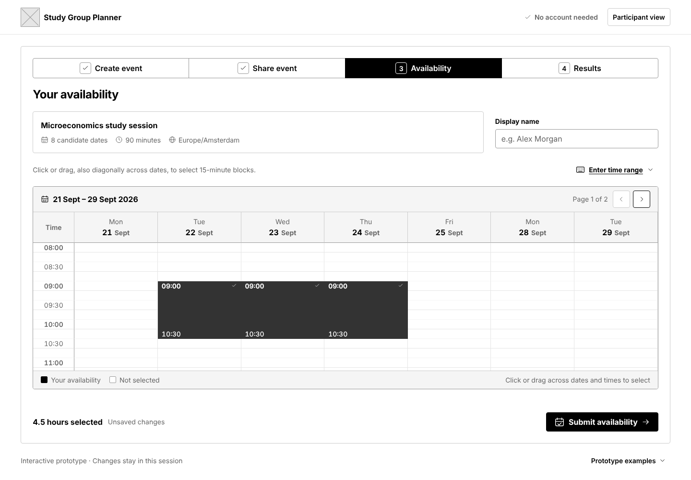

# Study Group Planner

A mid-fidelity, clickable web prototype that helps first-year international students find a study time that works for the whole group. An organiser creates an event, shares a link, everyone marks when they are free, and the app shows the times that fit **everyone**.

Built for TU Delft CSE12B *Human Computer Interaction & AI-Assisted Prototyping* (HAIP), Group 36. The code was generated and iterated in **Figma Make** (file `testHAIP`) and exported here.



## Quick start

Requirements: Node.js 20+ (22 recommended) and pnpm (or npm).

```bash
git clone https://github.com/TanBaoDA/study-group-planner.git
cd study-group-planner
pnpm install        # or: npm install
pnpm dev            # open the URL Vite prints, e.g. http://localhost:5173
```

Other scripts:

| Command | What it does |
| --- | --- |
| `pnpm build` | Production build into `dist/` (static files, can be hosted on Vercel/Netlify) |
| `pnpm preview` | Serve the production build locally |
| `pnpm test` | Run the 11 unit tests for the matching logic (`src/planner.test.mjs`) |
| `pnpm typecheck` | TypeScript check |

Open a specific screen directly with `?view=create`, `?view=share`, `?view=availability` or `?view=results`.

## What the prototype does

1. **Create event**: title, candidate dates (month picker), session duration, daily survey window.
2. **Share event**: participant link and private organiser link (demo links, nothing is stored).
3. **Availability**: participant enters a display name and marks free 15-minute blocks.
   - Click a cell to toggle it.
   - **Drag in any direction, including diagonally**: the rectangle between the start cell and the current cell (across dates and times) is selected, like when2meet. Starting a drag on a selected cell erases the rectangle instead. Works with mouse, touch and pen.
   - Or type a time range with "Enter time range".
4. **Results**: computes every interval of the chosen duration where all respondents are free; the best match is highlighted. "View individual availability" lists each person's free times **as text** per date (e.g. `Mon 21 Sept 10:00–11:00`), no per-person grid.

The "Prototype examples" menu (bottom right) loads demo scenarios (no responses yet, no shared time, etc.) for usability tests.

**Prototype limits:** no backend and no accounts. All state lives in memory and resets on reload; respondents are synthetic examples.

## Design rules (keep these when you change the UI)

- **Mid-fidelity wireframe style.** Grayscale only: `#000 #333 #666 #999 #ccc #e5e5e5 #f5f5f5 #fff`. No hues, gradients, shadows or illustrations.
- One font (`system-ui`), sizes 14 / 16 / 24 px, bold for headings.
- Images, logo and avatars are placeholders: grey box with a diagonal X (`.wireframe-placeholder`).
- Buttons 40 px high, 4 px radius. Primary = black fill + white text, secondary = white + black border, tertiary = underlined text.
- Spacing on an 8 px grid; cards have a 1 px `#ccc` border.
- Time unit is **15 minutes** everywhere (`SLOT_MINUTES` in `src/planner.ts`): durations 15–1440 min in 15-min steps, survey window in 15-min steps, one grid row per 15 min.
- Accessibility: contrast at least 4.5:1, visible black focus outline, all controls reachable by keyboard.

## Project structure

```
index.html                 HTML shell
src/main.tsx               React entry point
src/App.tsx                All screens: create, share, availability (grid + drag), results
src/components/
  PlannerControls.tsx      Duration stepper and 24h clock time fields
  Icons.tsx                Inline line icons
src/planner.ts             Pure logic: slots, matching (findMatches), ranges, validation
src/planner.test.mjs       Node unit tests for planner.ts
src/index.css              All styling (Tailwind v4 import + plain CSS classes)
docs/                      Screenshots and the Figma Make prompts used
```

Stack: React 19, TypeScript, Vite 8, Tailwind CSS v4 (mostly plain CSS classes in `index.css`).

Key concepts in code:
- `Availability = Record<date, slotIndex[]>`, where `slotIndex = minutes / 15` (e.g. 09:00 = 36).
- `findMatches(responses, dates, duration, start, end)` returns every 15-min-aligned interval where every respondent has every slot.
- Diagonal drag lives in `AvailabilityCalendar` (`applyDrag`, `onGridPointerMove`) in `src/App.tsx`.

## Editing with Figma Make or another AI tool

- **Figma Make:** the live source of this prototype is the Make file `testHAIP` (owner: Tấn Bảo Võ). To work in Figma, ask for access to that file or duplicate it. To bring code from this repo into a Make file, upload the files from `src/` in the Make chat and ask Make to use them as the project source.
- **Other LLMs (Claude, ChatGPT, Cursor, Copilot, ...):** give the tool this repo or a zip of it and point it to [`AGENTS.md`](AGENTS.md), which lists the rules an AI should follow (design rules above, keep tests passing, don't break the drag selection).
- Prompts we already used in Figma Make are in [`docs/figma-make-prompts.md`](docs/figma-make-prompts.md) (useful for the D3 "AI Use" section).

After any change, run `pnpm test`, `pnpm typecheck` and `pnpm build`, and click through all four screens.

## Hướng dẫn nhanh (Tiếng Việt)

1. Cài Node.js 22 và pnpm (`npm i -g pnpm`).
2. `git clone` repo này, vào thư mục, chạy `pnpm install` rồi `pnpm dev`, mở link hiện ra.
3. Muốn sửa bằng AI khác: đưa cả repo (hoặc file zip) cho AI và bảo nó đọc `AGENTS.md` trước. Sửa xong chạy `pnpm test` và `pnpm build` để chắc không hỏng gì.
4. Muốn sửa trong Figma Make: xin quyền vào file `testHAIP` hoặc duplicate nó; hoặc tải các file trong `src/` lên khung chat của Make.
5. Giữ đúng phong cách mid-fi: chỉ đen trắng xám, một font, ảnh là ô xám có dấu X, bước thời gian 15 phút.
